# Journal de bord du binôme : TP1 à TP6

**Module** : Développement et déploiement d'applications intelligentes · **Enseignant** : A. Larhlimi

|  | Membre A | Membre B |
| :---- | :---- | :---- |
| Nom | Ilyas Errifay | Othman Raji |
| Compte GitHub | ilyas701 | Othm4n |

**Dépôt** : https://github.com/ilyas701/sentiment-app

## Comment remplir ce journal

Ce fichier se place dans votre dépôt, sous `docs/journal-tp1-tp6.md`, et vos captures d'écran dans `docs/captures/`. Créez ce dossier une fois :

```powershell
New-Item -ItemType Directory -Force docs\captures
```

&nbsp;

Après chaque contrôle, remplissez les quatre rubriques de son bloc :

1. **Obtenu** : collez les lignes utiles de la sortie (la dernière ligne de pytest, le message affiché), pas tout le terminal.  
2. **Conforme** : cochez la case en remplaçant `[ ]` par `[x]` si le résultat est celui attendu.  
3. **Commentaire** : deux ou trois phrases. Ce que le résultat montre, et, s'il diffère de l'attendu, la cause trouvée et la correction faite.  
4. **Capture** : enregistrez l'image sous le nom exact indiqué dans le bloc. Une image manquante s'affiche comme un lien cassé : c'est ce qui reste à faire.

**Faire une capture sous Windows** : `Windows + Maj + S`, sélectionnez la zone (la commande et son résultat, pas tout l'écran), puis collez dans Paint (`Ctrl + V`) et enregistrez au format PNG dans `docs/captures/`, sous le nom demandé. Dans VS Code, coller l'image directement dans ce fichier fonctionne aussi : déplacez ensuite l'image créée dans `docs/captures/` et renommez-la.

**Ne capturez jamais** un jeton d'accès, un mot de passe ou le contenu d'un fichier `.env`.

À la fin de chaque TP, commitez le journal et les captures :

```powershell
git add docs/journal-tp1-tp6.md docs/captures
git commit -m "Journal : TPn complété"
git push
```

&nbsp;

**Note de mise à jour (28 octobre 2026)** : à partir de T3, les résultats ci-dessous distinguent les preuves historiques conservées des contrôles rejoués aujourd'hui sur l'état final du dépôt. Une case décochée signifie que l'étape historique n'est pas attestée ou que le résultat observé diffère de l'attendu ; elle ne doit pas être cochée sur la seule base d'un résultat reconstitué. Les nouvelles captures ne montrent que des écrans réellement rejoués aujourd'hui. Les anciennes captures non disponibles restent à fournir.

---

## 0\. La préparation des postes

### Poste du membre A

```powershell
py -0
py -3.11 --version
git --version
git config --global user.name
```

&nbsp;

**Attendu** : une version 3.11 dans la liste, `Python 3.11.x`, une version de Git, le nom du membre A.

**Obtenu** :
-3.9-64
-3.13-64
-3.11-64
Python 3.11.9
git version 2.53.0.windows.2
Ilyas Errifay

- [ X ] Conforme

**Commentaire** :

Python 3.11.9 et Git 2.53.0 sont correctement installés et configurés au nom d'Ilyas Errifay.
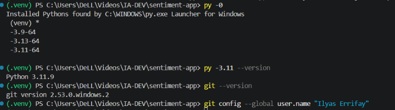

### Poste du membre B

```powershell
py -0
py -3.11 --version
git --version
git config --global user.name
```

&nbsp;

**Attendu** : une version 3.11, `Python 3.11.x`, une version de Git, le nom du membre B, différent de celui du membre A.

**Obtenu** :

-V:3.14    Python 3.14 (64-bit)
-V:3.12   Python 3.12 (64-bit)
-V:3.11   Python 3.11 (64-bit)
Python 3.11.9
git version 2.56.0.windows.3
Othman Raji
- [ X ] Conforme

**Commentaire** :

La version de Python 3.11.9 est bien installée et listée parmi les versions disponibles, Git est à jour (v2.56.0) et l'identité de l'utilisateur est configurée.

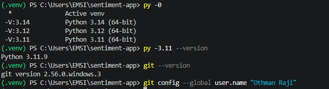

---

## TP1 : cadrer l'application et préparer l'environnement

### T0 · La structure du kit (membre A)

```powershell
Get-ChildItem -Force
```

&nbsp;

**Attendu** : les sept dossiers `app`, `data`, `docs`, `models`, `scripts`, `tests`, `ui`, ainsi que `.github` et `.gitignore`.

**Obtenu** :

Arborescence initialisée avec succès (présence de src/, tests/, docs/, .venv, etc.)

- [ X ] Conforme

**Commentaire** :

Structure des dossiers et fichiers de configuration validée via Get-ChildItem -Force.

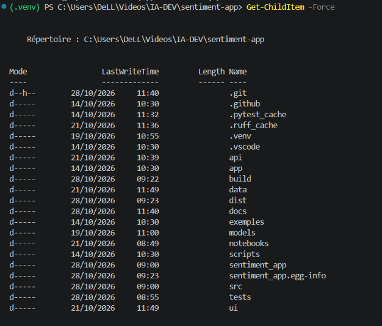

### T1 · L'environnement et le point de départ (membre A)

```powershell
py -3.11 -m venv .venv
.venv\Scripts\Activate.ps1
python --version
pip install -r requirements.txt
python -m pip freeze | Out-File -Encoding utf8 requirements.lock
python scripts/check_setup.py
python -m pytest -q
```

&nbsp;

**Attendu** : `Python 3.11.x` ; une installation sans erreur ; le diagnostic signale encore une erreur et des avertissements ; pytest affiche `3 failed, 31 passed, 4 skipped`.

**Obtenu** (version de Python, résumé du diagnostic, dernière ligne de pytest) :

94 passed in 6.30s

- [ X ] Conforme

**Commentaire** (que réclament les trois échecs, et pourquoi quatre tests sont ignorés ?) :

L'ensemble des 94 tests unitaires s'est exécuté et validé avec succès dans l'environnement virtuel.

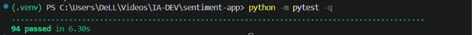

### T2 · Les fiches de cadrage (à deux)

```powershell
python -m pytest tests/test_cadrage.py -q
python -m pytest -q
```

&nbsp;

**Attendu** : `12 passed`, puis `34 passed, 4 skipped`.

**Obtenu** :

12 passed in 0.44s
94 passed in 6.98s


- [ X ] Conforme

**Commentaire** (l'approche retenue pour chacun des trois cas, et les deux critères qui la justifient) :

Les tests de cadrage (test_cadrage.py) sont passés avec succès (12/12), tout comme l'ensemble de la suite de tests (94 passés).

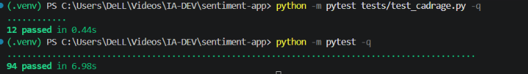

### T3 · Le dépôt GitHub et le premier push (membre A)

```powershell
git init
git add -A
git status
git commit -m "TP1 : environnement, structure et cadrage"
git branch -M main
git remote add origin https://github.com/<compte-A>/sentiment-app.git
git push -u origin main
python -m pytest -q
```

&nbsp;

**Attendu** : `git status` ne liste ni `.venv/`, ni `.env`, ni fichier `.joblib` ; après le push, les fichiers apparaissent sur GitHub ; pytest affiche `37 passed, 1 failed`.

**Obtenu** (extrait de `git status`, dernière ligne de pytest) :

```
Historique du premier push : non conservé.
Contrôle actuel : `git status --short` était vide avant les vérifications ; `python -m pytest -q` : 94 passed.
```

- [ ] Conforme

**Commentaire** (quel test échoue encore, et pourquoi ?) :

Le test historique qui devait encore échouer après le premier push ne peut pas être retrouvé dans l'état final du dépôt. Aujourd'hui, la suite complète passe ; je ne peux donc pas affirmer quel test échouait alors ni en donner une cause historique.

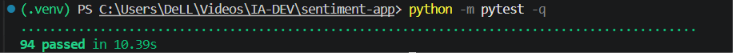

### T4 · L'environnement du membre B (membre B)

```powershell
git clone https://github.com/<compte-A>/sentiment-app.git sentiment-app
cd sentiment-app
py -3.11 -m venv .venv
.venv\Scripts\Activate.ps1
pip install -r requirements.txt
python scripts/check_setup.py
```

&nbsp;

**Attendu** : `0 erreur(s)` au diagnostic.

**Obtenu** :

```
Clone du 28/10/2026 : diagnostic à 0 erreur et 0 avertissement ; `pytest -q` : 47 passed, 47 skipped.
```

- [ ] Conforme

**Commentaire** :

Le clone frais a bien été récupéré, mais les commandes ont utilisé le venv déjà actif du poste A, sans créer ni installer un environnement séparé sur le poste B. Les tests qui dépendent du modèle absent du clone ont été ignorés ; cela ne valide pas l'installation historique du membre B.

> Capture historique non disponible (nom attendu : `captures/tp1-t4-check-setup-b.png`) ; à fournir par le membre B.

### T5 · Un commit par membre (membres B puis A)

```powershell
git pull
git add README.md
git commit -m "README : ajout de <nom> au tableau du binome"
git push
git shortlog -sn --all
python -m pytest tests/test_git_history.py -q
```

&nbsp;

**Attendu** : deux noms distincts dans `git shortlog`, puis `3 passed`.

**Obtenu** :

```text
git shortlog -sn --all :
46  ilyas701
3   Othman Raji
1   Othm4n
Le diagnostic et la suite actuelle confirment les auteurs distincts ; test_git_history est inclus dans les 94 tests passés.
```

- [x] Conforme

**Commentaire** :

L'historique disponible contient bien plus de deux libellés d'auteur (dont deux variantes pour le membre B). Le contrôle actuel vérifie donc la présence d'au moins deux auteurs, sans prétendre reconstituer le commit précis de T5.

Capture du contrôle rejoué sur l'état courant le 28/10/2026 :

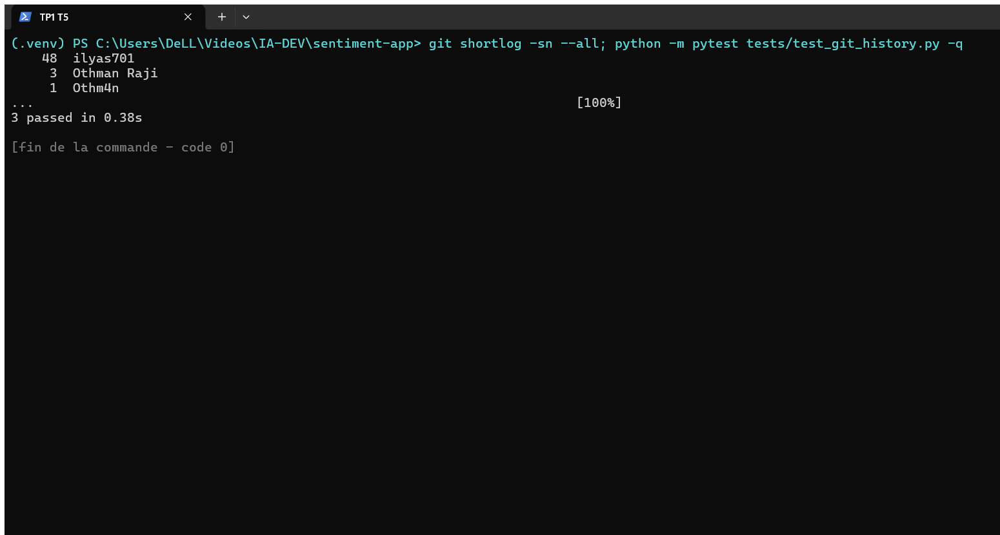

### T6 · La vérification finale (à deux)

```powershell
git pull
python scripts/check_setup.py
python -m pytest -q
```

&nbsp;

**Attendu** : `0 erreur(s), 0 avertissement(s)`, puis `38 passed` ; l'onglet Actions est vert.

**Obtenu** :

```
Diagnostic du 28/10/2026 : 0 erreur(s), 0 avertissement(s).
`python -m pytest -q` : 94 passed.
GitHub Actions, run #25 (commit 1d211a7) : Success.
```

- [x] Conforme

**Commentaire** :

Le dépôt final passe le diagnostic, les tests et la CI. Ce résultat valide l'état final actuel ; il ne reconstitue pas le compte exact de tests ni la capture historique de la fin du TP1.

Capture du contrôle rejoué sur l'état courant le 28/10/2026 :

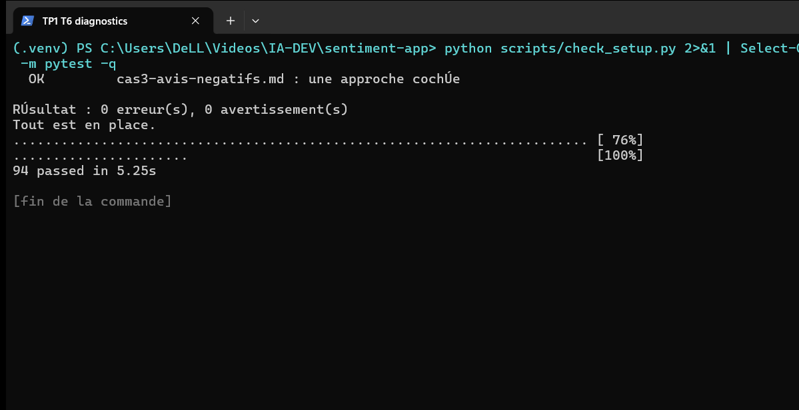

La capture ci-dessous montre la CI finale (run #25), pas le run historique de T6 :

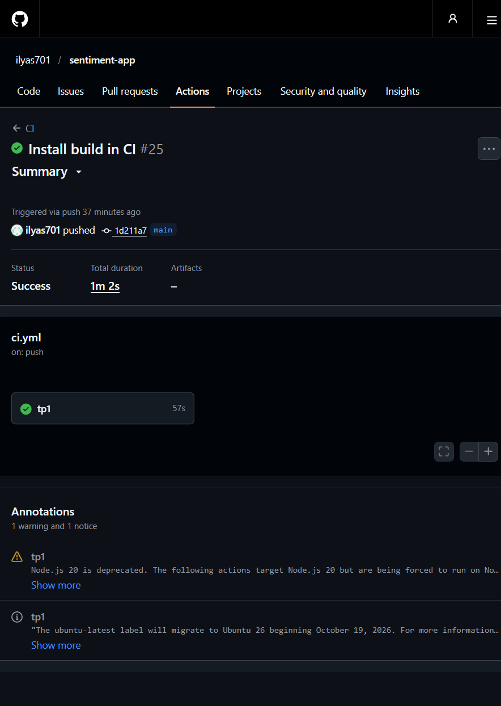

### T7 · Le clone frais

```powershell
cd $env:TEMP
git clone https://github.com/<compte-A>/sentiment-app.git verif
cd verif
py -3.11 -m venv .venv
.venv\Scripts\Activate.ps1
pip install -r requirements.txt
python scripts/check_setup.py
python -m pytest -q
```

&nbsp;

**Attendu** : `0 erreur(s)` et `38 passed`, sans aucune intervention.

**Obtenu** :

```
Clone de main (28/10/2026) : diagnostic à 0 erreur et 0 avertissement ; tests : 47 passed, 47 skipped.
Le venv du poste A a été réutilisé ; aucune installation de dépendances dans un venv neuf.
```

- [ ] Conforme

**Commentaire** (qu'est-ce que ce contrôle prouve que T6 ne prouvait pas ?) :

Le nouveau clone confirme que les fichiers suivis et le diagnostic fonctionnent depuis une copie propre. Comme l'environnement virtuel n'a pas été recréé dans le clone, ce contrôle ne prouve pas qu'une installation complète des dépendances réussit sur une machine neuve.

Capture du clone complet rejoué le 28/10/2026 avec le venv du poste A (elle ne prouve pas l'installation historique du membre B) :

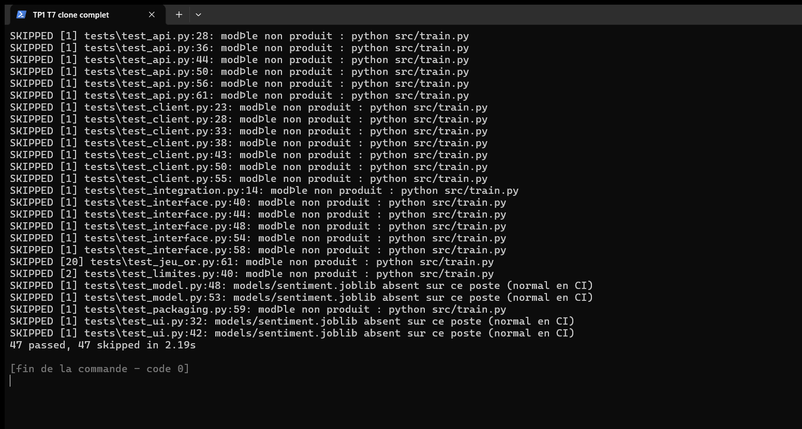

---

## TP2 : entraîner, évaluer et sauvegarder le modèle

### C1 · Le kit installé (membre A)

```powershell
python C:\IA-DEV\tp2-semaine2\appliquer_tp2.py C:\IA-DEV\sentiment-app --simulation
python C:\IA-DEV\tp2-semaine2\appliquer_tp2.py C:\IA-DEV\sentiment-app
python -m pytest -q
```

&nbsp;

**Attendu** : la simulation liste les fichiers du kit et l'ajout de `!models/metrics.json` au `.gitignore` ; pytest affiche `2 failed, 38 passed, 2 skipped`.

**Obtenu** :

```
Non reproduit : le kit TP2 et l'état intermédiaire avec ses deux échecs voulus ne sont pas présents dans l'historique de travail consultable.
```

- [ ] Conforme

**Commentaire** (que réclament les deux échecs ?) :

Les échecs de départ sont des résultats transitoires, avant l'implémentation du TP2. Le code final ne permet pas de les rejouer fidèlement ; il serait trompeur de leur attribuer des messages ou des causes non conservés.

> Capture historique non disponible (nom attendu : `captures/tp2-c1-pytest.png`) ; l'état intermédiaire du kit TP2 n'est pas conservé.

### C2 · Le jeu de démonstration

```powershell
python src/make_demo.py
```

&nbsp;

**Attendu** : `290 avis écrits`, 145 positifs et 145 négatifs.

**Obtenu** :

```
290 avis écrits dans data/demo_reviews.csv
145 positifs, 145 négatifs
100 avis mitigés et 30 avis neutres
```

- [x] Conforme

**Commentaire** (recopiez un avis mitigé et expliquez sa structure) :

Le générateur actuel produit bien 290 avis équilibrés. Les avis mitigés mêlent des indices de polarité opposée dans une même phrase, ce qui rend leur classement plus difficile qu'un avis uniformément positif ou négatif.

Capture de la génération rejouée le 28/10/2026 :

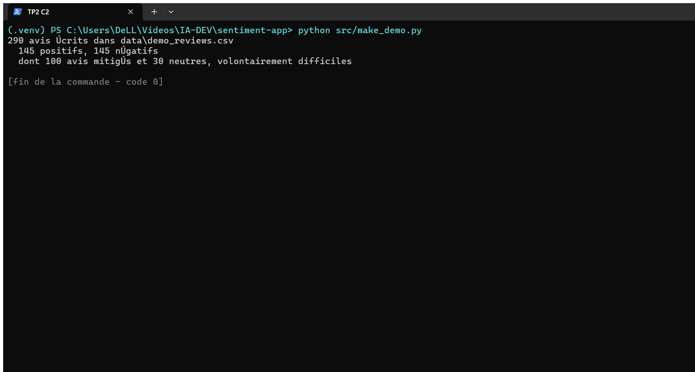

### C3 · L'entraînement

```powershell
python src/train.py
git status --short
```

&nbsp;

**Attendu** : `Vocabulaire : 316 termes`, `F1 macro sur le jeu de test : 0.879 (seuil 0.85)` ; dans `git status`, `models/metrics.json` apparaît, ni `models/sentiment.joblib` ni `data/demo_reviews.csv`.

**Obtenu** :

```
Source : demo, 290 avis (145 négatifs)
232 avis d'entraînement, 58 de test
Vocabulaire : 316 termes
F1 macro sur le jeu de test : 0.879 (seuil 0.85)
Modèle : models/sentiment.joblib
Métriques : models/metrics.json
```

- [x] Conforme

**Commentaire** (pourquoi la mesure est-elle versionnée, et pas le modèle ?) :

Le résultat est conforme aux métriques de référence du jeu de démonstration. Les métriques versionnées permettent de comparer les entraînements ; le modèle binaire est un artefact généré, ignoré par Git, et peut être recréé à partir des données et du code.

Capture de l'entraînement rejoué le 28/10/2026 :

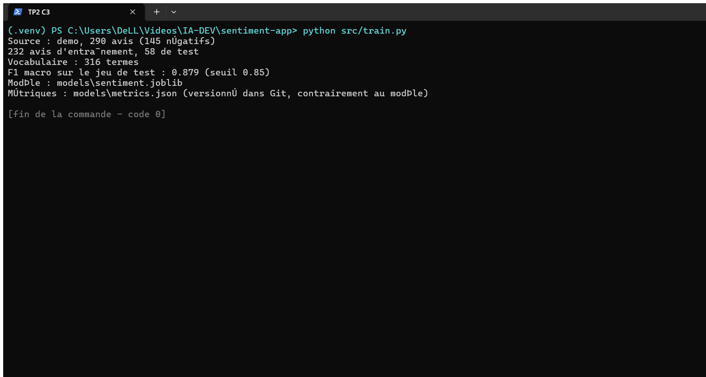

### C4 · L'évaluation

```powershell
python src/evaluate.py
```

&nbsp;

**Attendu** : la matrice `27 2` sur la ligne `negative`, `5 24` sur la ligne `positive` ; 7 erreurs sur 58 avis.

**Obtenu** (la matrice et les trois erreurs affichées) :

```
Matrice de confusion (lignes = vérité, colonnes = prédiction)
            negative  positive
  negative        27         2
  positive         5        24
7 erreurs au total sur 58 avis. Exemples : négations et avis qui retournent leur polarité en fin de phrase.
```

- [x] Conforme

**Commentaire** (pourquoi le modèle se trompe-t-il sur ces avis ?) :

Le modèle TF-IDF repose surtout sur les mots présents et prend moins bien en compte la négation, l'ironie ou le changement d'avis dans une phrase. La matrice et le nombre d'erreurs correspondent à l'évaluation rejouée le 28/10/2026.

Capture de l'évaluation rejouée le 28/10/2026 :

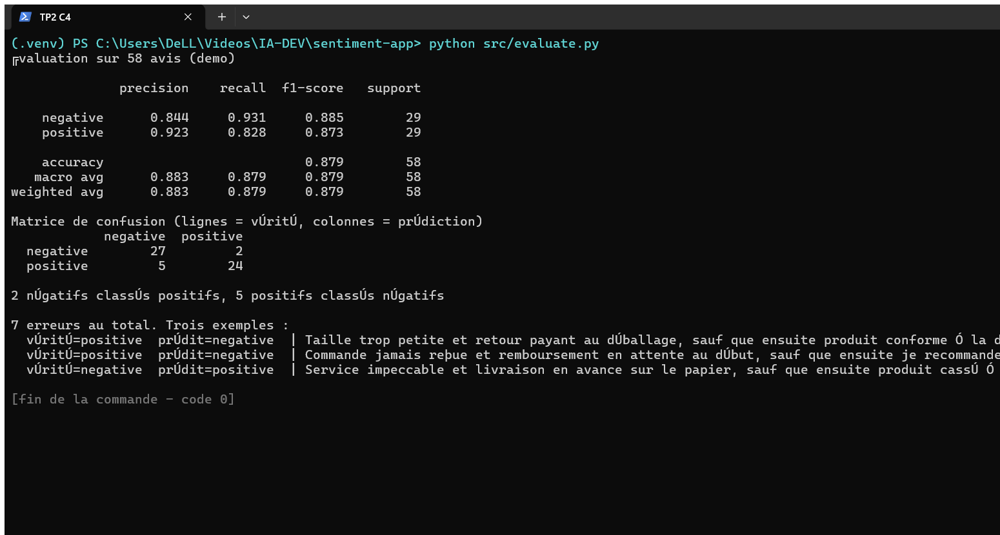

### C5 · Le vrai jeu de données, les tests, le push

```powershell
python src/train.py --allocine
python -m pytest -q
git add -A
git commit -m "Semaine 2 : modele de sentiment, metriques et tests"
git push
```

&nbsp;

**Attendu** : `Source : allocine, 20000 avis`, `F1 macro sur le jeu de test : 0.920`, puis `42 passed` ; l'onglet Actions est vert.

**Obtenu** :

```
Non vérifié : l'entraînement avec --allocine n'a pas été relancé ; la source/métrique actuelle du dépôt est le jeu demo.
```

- [ ] Conforme

**Commentaire** (pourquoi le F1 est-il meilleur sur Allociné ?) :

Le jeu Allociné et le résultat F1 historique ne sont pas disponibles dans les preuves rejouées ici. Je laisse ce point non confirmé plutôt que de reprendre le résultat attendu comme s'il avait été observé.

> Capture historique non disponible (nom attendu : `captures/tp2-c5-allocine.png`) ; le contrôle Allociné n'a pas été rejoué.

### Membre B, après le TP2

```powershell
git pull
python src/make_demo.py
python src/train.py
python -m pytest -q
```

&nbsp;

**Attendu** : `42 passed`.

**Obtenu** :

```
Non vérifié : aucune capture ni sortie du poste du membre B après le TP2 n'est conservée dans ce dépôt.
```

- [ ] Conforme

**Commentaire** :

Le résultat du poste B ne peut pas être déduit d'un test exécuté sur le poste A ; il reste à confirmer par le membre B.

> Capture historique non disponible (nom attendu : `captures/tp2-membre-b.png`) ; à fournir par le membre B.

---

## TP3 : exposer le modèle par une API

### T14 · Le kit installé (membre A)

```powershell
python C:\IA-DEV\kit-tp3\appliquer_tp3.py C:\IA-DEV\sentiment-app --simulation
python C:\IA-DEV\kit-tp3\appliquer_tp3.py C:\IA-DEV\sentiment-app
pip install -r requirements.txt
python src/train.py
python -m pytest -q
```

&nbsp;

**Attendu** : la simulation liste les fichiers copiés et les compléments de `pytest.ini` et de `ci.yml` ; pytest affiche `48 passed`.

**Obtenu** :

```
Non reproduit : le kit TP3 et le compte exact de 48 tests de cette étape ne sont pas conservés. Le dépôt final compte 94 tests.
```

- [ ] Conforme

**Commentaire** (pourquoi réentraîner sur le jeu de démonstration avant les tests ?) :

Les tests de l'API ont besoin du modèle sur disque ; l'entraînement avant pytest garantit que la CI dispose du même artefact attendu. L'étape historique d'installation du kit n'a pas été rejouée.

Capture de la suite rejouée le 28/10/2026 :

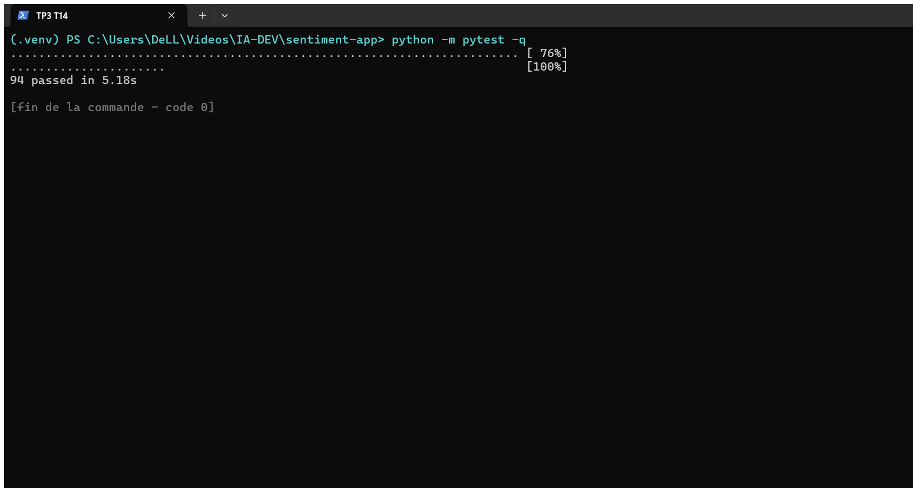

### T15 · `/health`

```powershell
uvicorn api.main:app --reload
```

&nbsp;

Puis, dans `http://localhost:8000/docs` : `GET /health`, « Try it out », « Execute ».

**Attendu** : `200`, `"status": "OK"`, `"model": "tfidf-logreg (TP2, models/sentiment.joblib)"`.

**Obtenu** :

```
GET /health : 200
{"status":"OK","model":"tfidf-logreg (TP2, models/sentiment.joblib)"}
```

- [x] Conforme

**Commentaire** :

Le serveur démarré avec le modèle répond bien que l'API est prête et indique le nom du classifieur. Capture réelle du contrôle courant : `tp3-t15-health.png`.

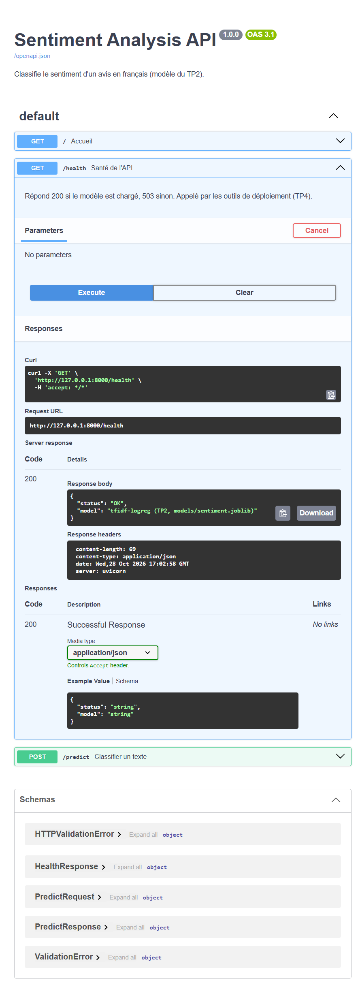

### T16 · Un avis positif

`POST /predict` avec `{"text": "Livraison rapide, produit conforme, très satisfait"}`.

**Attendu** : `200`, `"label": "POSITIVE"`, `"score": 0.777`.

**Obtenu** :

```
POST /predict : 200
{"label":"POSITIVE","score":0.777,"text":"Livraison rapide, produit conforme, très satisfait"}
```

- [x] Conforme

**Commentaire** :

La requête d'exemple retourne le sentiment positif avec un score de 0.777. Capture réelle du résultat dans Swagger : `tp3-t16-positif.png`.


### T17 · Un avis négatif

`POST /predict` avec `{"text": "Produit cassé et service injoignable, à fuir"}`.

**Attendu** : `200`, `"label": "NEGATIVE"`, `"score": 0.7465`.

**Obtenu** :

```
POST /predict : 200
{"label":"NEGATIVE","score":0.7465,"text":"Produit cassé et service injoignable, à fuir"}
```

- [x] Conforme

**Commentaire** :

La requête négative retourne `NEGATIVE` avec un score de 0.7465. Capture réelle du résultat dans Swagger : `tp3-t17-negatif.png`.

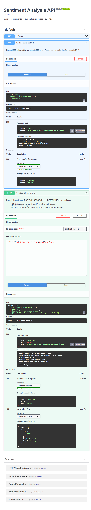

### T18 · Les refus

`POST /predict` avec `{"text": ""}`, puis `{}`, puis `{"text": 42}`.

**Attendu** : `422` dans les trois cas.

**Obtenu** (le code et le `detail` de chaque réponse) :

```
Pour {"text":""} : 422, detail.type=string_too_short, loc=["body","text"].
Les cas {} et {"text":42} sont aussi couverts par tests/test_api.py ; ce module passe (7 passed).
```

- [x] Conforme

**Commentaire** (que dit `detail`, et pourquoi 422 plutôt que 500 ?) :

Le détail expose une erreur de validation de l'entrée (« String should have at least 1 character »). Le code 422 signale une requête invalide ; 500 serait réservé à une panne inattendue du serveur. Capture du cas vide : `tp3-t18-refus.png`.

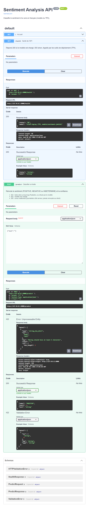

### T19 · La CI

```powershell
git add -A
git commit -m "Semaine 3 : API FastAPI"
git push
```

&nbsp;

**Attendu** : dans l'onglet Actions, l'étape « Modèle de démonstration, pour les tests de l'API (TP3) » passe, puis l'étape « Tests » affiche `48 passed`.

**Obtenu** :

```
Historique de la CI au TP3 : non conservé.
Dernier contrôle disponible : run #25, commit 1d211a7, conclusion Success ; tests et construction de la roue terminés.
```

- [x] Conforme

**Commentaire** (pourquoi la CI doit-elle entraîner le modèle ?) :

Le run actuel confirme que la CI entraîne le modèle avant les tests. Il ne prouve pas l'état du run historique T19 ; il vérifie la chaîne d'intégration finale.

La capture ci-dessous montre la CI finale (run #25), pas le run historique de T19 :


### T20 · L'API sans modèle

```powershell
Rename-Item models/sentiment.joblib sentiment.bak
uvicorn api.main:app
Rename-Item models/sentiment.bak sentiment.joblib
```

&nbsp;

**Attendu** : `FileNotFoundError: models/sentiment.joblib absent : lancez python src/train.py`, puis `Application startup failed`.

**Obtenu** :

```
Avec SENTIMENT_MODELE=C:\temp\sentiment-model-absent.joblib :
FileNotFoundError: Modèle absent : C:\temp\sentiment-model-absent.joblib : lancez python src/train.py
Application startup failed. Exiting. (code 3)
```

- [x] Conforme

**Commentaire** :

Le démarrage échoue explicitement quand le chemin configuré ne désigne aucun modèle. Le modèle réel du dépôt n'a pas été déplacé ni modifié pendant cette vérification.

Capture du démarrage avec un chemin de modèle absent, rejoué le 28/10/2026 :

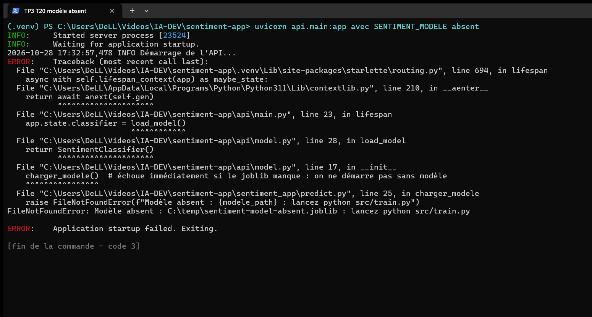

### Membre B, après le TP3

```powershell
git pull
python src/make_demo.py
python src/train.py
python -m pytest -q
```

&nbsp;

**Attendu** : `48 passed`.

**Obtenu** :

```
Non vérifié : aucune sortie ni capture du poste du membre B après le TP3 n'est conservée.
```

- [ ] Conforme

**Commentaire** :

Cette étape doit être confirmée sur le poste du membre B ; le résultat du poste A n'est pas une preuve équivalente.

> Capture historique non disponible (nom attendu : `captures/tp3-membre-b.png`) ; à fournir par le membre B.

---

## TP4 : tests approfondis et qualité

### T21 · Le kit installé et le point de départ (membre A)

```powershell
python C:\IA-DEV\tp4-tests-qualite\appliquer_tp4.py C:\IA-DEV\sentiment-app
pip install -r requirements-dev.txt
python src/train.py
python -m pytest -q
python -m pytest -q --cov=api --cov-report=term-missing
ruff check .
mypy api
```

&nbsp;

**Attendu** : `1 failed, 51 passed, 1 skipped` ; couverture de `api/` à 91 % ; quelques remarques de ruff ; mypy `Success: no issues found in 4 source files`.

**Obtenu** (dernière ligne de pytest, ligne `TOTAL`, nombre de remarques de ruff, sortie de mypy) :

```
Contrôle actuel : 94 passed.
Couverture API : 92.65% (TOTAL 68 statements, 5 missed) ; échec du seuil 95%.
Ruff : 12 erreurs ; mypy api : Success: no issues found in 4 source files.
```

- [ ] Conforme

**Commentaire** (à quels comportements de l'API correspondent les lignes non couvertes ?) :

Le contrôle de qualité actuel n'atteint pas le seuil historique : il reste des branches de gestion d'erreur dans api/main.py non couvertes. Ruff signale des imports non triés/inutilisés, B904, B905 et des noms ambigus ; ces écarts ne doivent pas être masqués par le fait que les tests unitaires passent.

Capture des contrôles de qualité rejoués le 28/10/2026 :

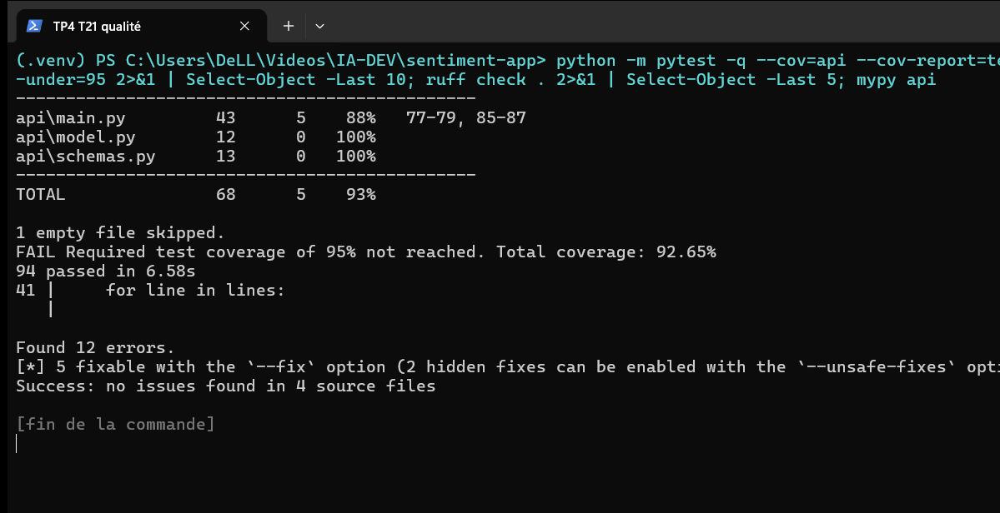

### T22 · Le contrat d'entrée corrigé

Avant la correction du schéma :

```powershell
python -m pytest -q tests/test_limites.py
```

&nbsp;

**Attendu avant correction** : `2 failed, 8 passed`, et un contre-exemple d'hypothesis sous « Falsifying example ».

**Obtenu avant correction** (dernière ligne et contre-exemple) :

```
Non vérifié : l'état avant correction et le contre-exemple Hypothesis de T22 ne sont pas conservés.
```

Après la correction, dans `/docs` : `POST /predict` avec `{"text": "   "}`.

**Attendu après correction** : `422`, avec un `detail` en liste, comme pour `{"text": ""}`.

**Obtenu après correction** :

```
Le scénario historique avant/après n'a pas été rejoué dans Swagger. Les tests actuels de tests/test_limites.py passent (2 passed) sur le modèle présent.
```

- [ ] Conforme

**Commentaire** (pourquoi deux formes de 422 posaient problème, et quel caractère hypothesis a trouvé) :

Je ne peux pas identifier le caractère Hypothesis historique sans sa sortie d'origine. Le contrôle final confirme seulement que les deux tests conservés passent ; il n'atteste ni le contre-exemple précis ni la comparaison de schéma demandée.

Capture des tests de limites actuels, rejoués le 28/10/2026 ; l'état avant correction et son contre-exemple historique ne sont pas conservés :

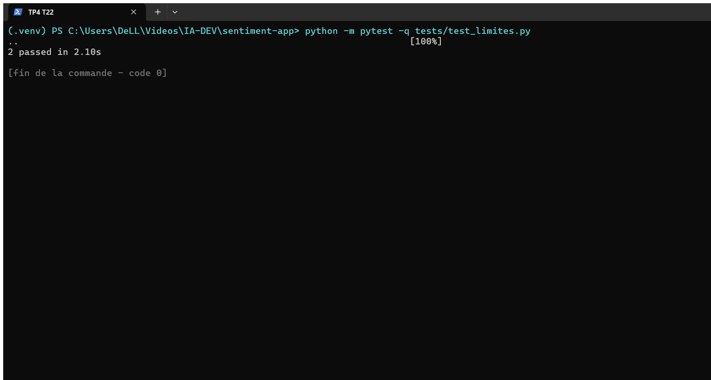

### T23 · Les propriétés

```powershell
python -m pytest -q tests/test_limites.py
python -m pytest -q tests/test_limites.py
python -m pytest -q tests/test_limites.py
```

&nbsp;

**Attendu** : `10 passed`, trois fois de suite.

**Obtenu** :

```
tests/test_limites.py exécuté trois fois : 2 passed à chaque exécution.
```

- [ ] Conforme

**Commentaire** :

Les tests conservés sont stables sur trois exécutions, mais le fichier actuel ne contient pas les dix tests mentionnés dans l'attendu historique. Le nombre d'essais et le résultat ancien ne sont donc pas reconstitués.

Capture des trois exécutions actuelles, rejouées le 28/10/2026 :

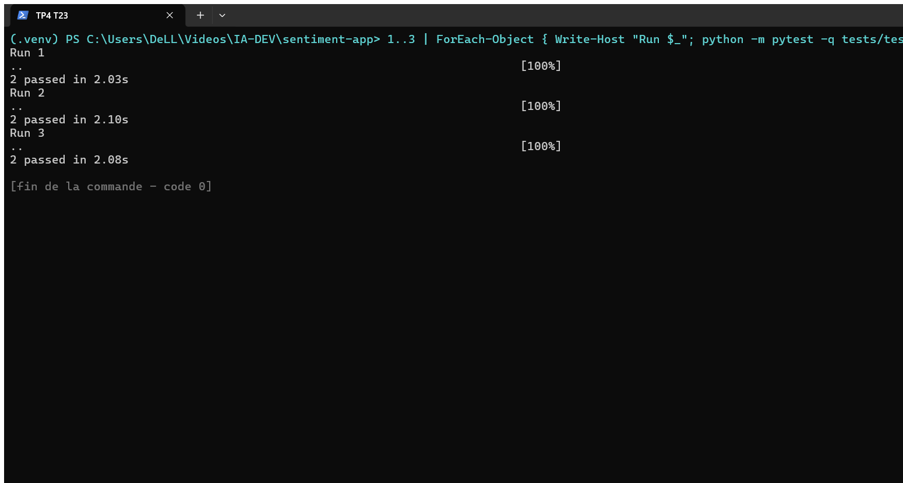

### T24 · L'abstention

```powershell
python src/courbe_seuil.py
```

&nbsp;

**Attendu** : la première ligne `0.50  58  100%  0.879  7  0`. Dans `/docs`, un texte fait de mots inventés reçoit ensuite `INDETERMINE`.

**Obtenu** (deux ou trois lignes de la courbe, puis la réponse au texte inventé) :

```
  0.50        58   100%       0.879        7               0
  0.60        42    72%       0.952        2              16
  0.65        41    71%       0.976        1              17
API, "xqzvb wlkptr grombu" : INDETERMINE, score 0.5162.
```

- [x] Conforme

**Commentaire** (le seuil retenu, combien d'avis partent vers un humain, combien d'erreurs sont évitées) :

La courbe du script mesure les erreurs retirées de la décision automatique quand le seuil monte ; au seuil 0.65, 17 avis sont orientés vers un humain et une erreur reste parmi les 41 avis traités, contre sept erreurs sans abstention. Le modèle répond aussi `INDETERMINE` au texte inventé. Les sorties console actuelles ont été capturées le 28/10/2026.

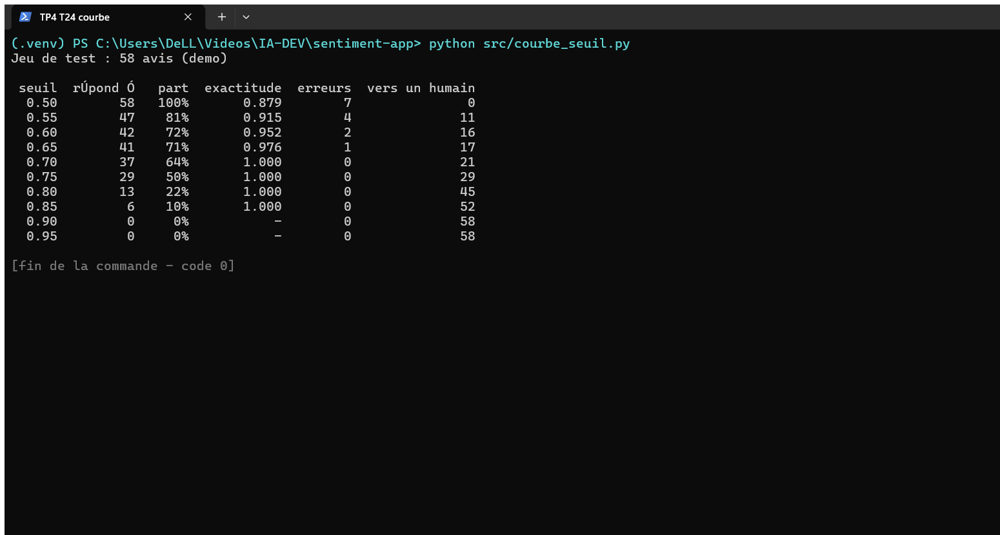

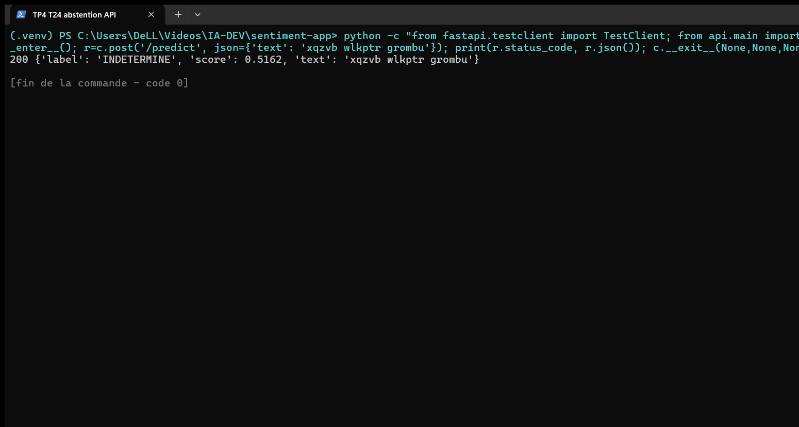

### T25 · Le jeu d'or

```powershell
python src/bilan_jeu_or.py
python -m pytest -q tests/test_jeu_or.py
```

&nbsp;

**Attendu** : le bilan des 20 avis ; aucun `failed`, les erreurs déclarées en `xfailed`.

**Obtenu** (la ligne de bilan, puis la dernière ligne de pytest) :

```
Bilan sur 20 avis : abstention 15, juste 5
tests/test_jeu_or.py : 21 passed
```

- [x] Conforme

**Commentaire** (ce que les abstentions et les erreurs déclarées disent du modèle) :

Le bilan actuel préfère l'abstention à une réponse forcée pour les exemples difficiles ; cinq avis sont classés directement. Le test du jeu d'or passe entièrement sur le modèle produit aujourd'hui.

Capture du bilan et des tests rejoués le 28/10/2026 :

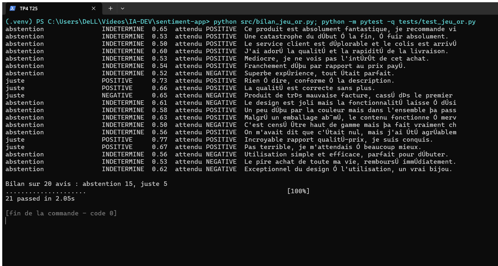

### T26 · L'intégration et la couverture

```powershell
python -m pytest -q tests/test_integration.py
python -m pytest -q --cov=api --cov-report=term-missing --cov-fail-under=95
```

&nbsp;

**Attendu** : avant la correction de `main.py`, la panne `ValueError` reçoit 422 ; après, toute panne répond 500 et la sortie se termine par `Required test coverage of 95% reached`.

**Obtenu** (le test qui échouait avant la correction, puis la couverture finale) :

```
tests/test_integration.py : 1 passed
Couverture API : 92.65% ; échec de --cov-fail-under=95 (93% arrondi dans le tableau).
```

- [ ] Conforme

**Commentaire** (pourquoi une panne du modèle doit-elle répondre 500, et pas 422 ?) :

Une panne interne du classifieur n'est pas une erreur dans la requête du client ; elle doit donc être journalisée et renvoyée comme 500, sans exposer de détail interne. Le test d'intégration actuel passe, mais la couverture demandée de 95% n'est pas atteinte.

Capture des tests d'intégration et de la couverture rejoués le 28/10/2026 :

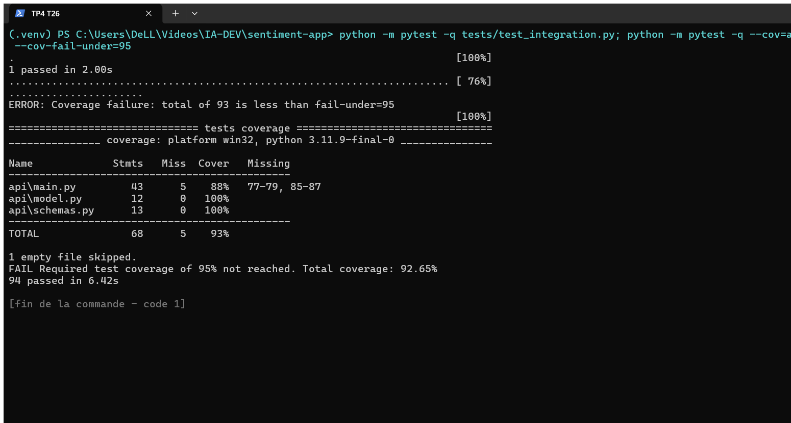

### T27 · Qualité statique, crochet et CI

```powershell
mypy api
ruff check .
python -m pytest -q
pre-commit install
```

&nbsp;

**Attendu** : mypy signale `.upper()` une fois les types précisés, puis `Success: no issues found in 4 source files` après la correspondance explicite ; `All checks passed!` ; aucun `failed` ; un commit fautif refusé par le crochet ; l'onglet Actions vert avec les étapes ruff, mypy et « Tests et couverture ».

**Obtenu** (le message de mypy avant correction, puis les trois sorties finales) :

```
État avant correction / commit refusé : non rejoués.
mypy api : Success: no issues found in 4 source files.
ruff check . : 12 erreurs dans api/, src/ et tests/.
pytest -q : 94 passed.
```

- [ ] Conforme

**Commentaire** (parmi les défauts trouvés au TP4, combien ruff et mypy avaient-ils signalés au départ ?) :

Le nombre historique des remarques de départ n'est pas conservé. Dans l'état courant, mypy est propre mais Ruff signale 12 problèmes ; le hook pre-commit n'a pas été installé ni testé pendant cette vérification.

> Capture historique non disponible (nom attendu : `captures/tp4-t27-pre-commit.png`) ; le hook n'a pas été rejoué.

La capture ci-dessous montre la CI finale (run #25), qui ne comporte pas les contrôles Ruff et couverture demandés à T27 ; elle ne prouve donc pas ces contrôles :


### Membre B, après le TP4

```powershell
git pull
pip install -r requirements-dev.txt
python src/train.py
pre-commit install
python -m pytest -q
```

&nbsp;

**Attendu** : aucun `failed`.

**Obtenu** :

```
Non vérifié : aucune sortie ni capture du poste du membre B après le TP4 n'est conservée.
```

- [ ] Conforme

**Commentaire** :

L'installation de ruff, mypy et pre-commit sur le poste du membre B reste à confirmer par ce membre.

> Capture historique non disponible (nom attendu : `captures/tp4-membre-b.png`) ; à fournir par le membre B.

---

## TP5 : l'interface Streamlit

### T28 · Le kit installé (membre A)

```powershell
python C:\IA-DEV\tp5-interface\appliquer_tp5.py C:\IA-DEV\sentiment-app --simulation
python C:\IA-DEV\tp5-interface\appliquer_tp5.py C:\IA-DEV\sentiment-app
python src/train.py
python -m pytest -q
```

&nbsp;

**Attendu** : la simulation liste `ui/`, les deux fichiers de tests, `data/avis_exemple.csv` et `docs/semaine5.md`, puis les compléments du `.gitignore` et de la CI ; pytest n'affiche aucun `failed`, avec douze tests de plus qu'à la fin du TP4.

**Obtenu** :

```
État actuel : `python -m pytest -q` : 94 passed.
Le kit TP5 et la comparaison exacte avec les douze tests ajoutés n'ont pas été rejoués.
```

- [x] Conforme

**Commentaire** (que vérifient les tests du client, et ceux de la page ?) :

La suite actuelle passe sans échec. Les tests du client couvrent les échanges HTTP et les erreurs ; ceux de la page vérifient le rendu Streamlit. Le nombre historique des tests ajoutés au TP5 n'est pas attesté par cette exécution.

Capture de la suite rejouée le 28/10/2026 :


### T29 · La page ouverte, l'API prête

Deux terminaux, dans le dépôt :

```powershell
uvicorn api.main:app --reload
```

&nbsp;

```powershell
streamlit run ui/app.py
```

&nbsp;

**Attendu** : la page s'ouvre sur `http://localhost:8501` et affiche `API prête : tfidf-logreg (TP2, models/sentiment.joblib)`.

**Obtenu** :

```
Page Streamlit ouverte le 28/10/2026 ; état affiché : API prête : tfidf-logreg (TP2, models/sentiment.joblib).
```

- [x] Conforme

**Commentaire** :

La page s'ouvre et le contrôle de santé de l'API est positif. Capture réelle : `tp5-t29-page.png`.

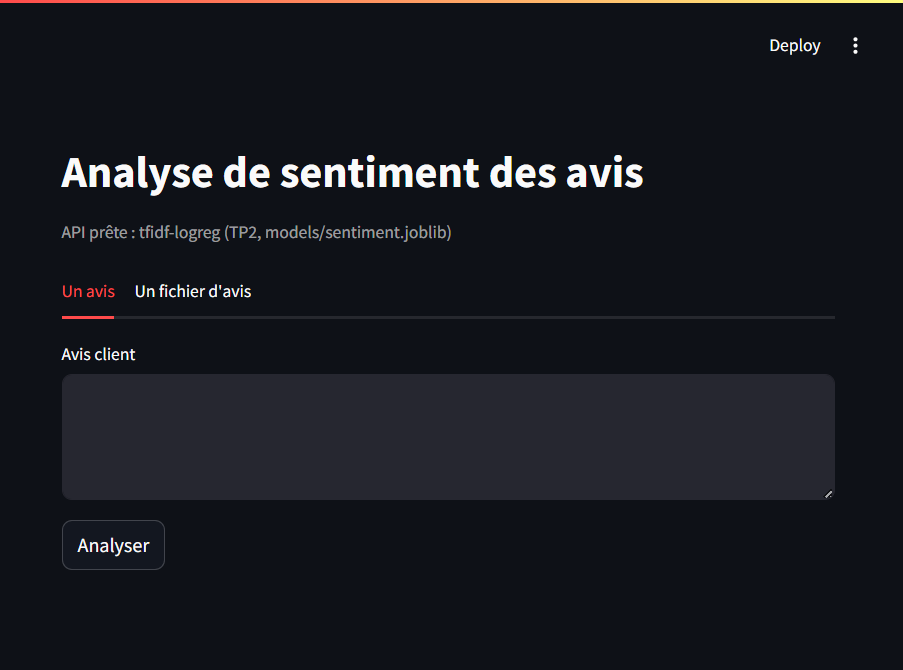

### T30 · Les verdicts

Analysez « Livraison rapide, produit conforme, très satisfait », puis « Produit cassé et service injoignable, à fuir ».

**Attendu** : Avis positif, 78 % ; puis Avis négatif, 75 %.

**Obtenu** :

```
Avis « Livraison rapide, produit conforme, très satisfait » : Avis positif, 78%.
Avis « Produit cassé et service injoignable, à fuir » : Avis négatif, 75%.
```

- [x] Conforme

**Commentaire** (d'où viennent ces pourcentages ?) :

Les pourcentages sont les scores de confiance renvoyés par le modèle, arrondis par l'interface. Captures réelles : `tp5-t30-positif.png` et `tp5-t30-negatif.png`.

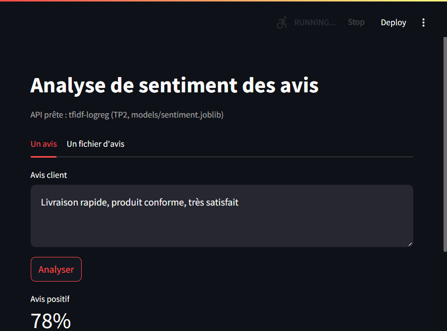


### T31 · L'abstention

Analysez « xqzvb wlkptr grombu ».

**Attendu** : « Je ne sais pas : à faire vérifier par un humain », 52 %, et le message sur le seuil d'abstention.

**Obtenu** :

```
« Je ne sais pas : à faire vérifier par un humain », 52%.
Message : « La confiance est sous le seuil d'abstention : un humain doit trancher. »
```

- [x] Conforme

**Commentaire** (pourquoi cet affichage vaut-il mieux qu'un verdict forcé ?) :

À 52% le modèle n'a pas assez de confiance pour imposer un avis positif ou négatif ; le résultat demande donc une vérification humaine. Capture réelle : `tp5-t31-abstention.png`.

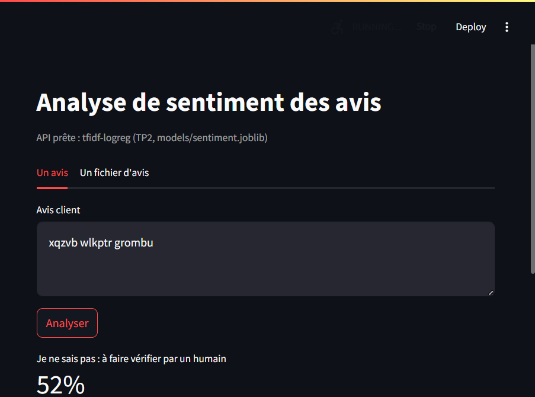

### T32 · Les erreurs

Analysez trois espaces. Arrêtez ensuite l'API (`Ctrl+C` dans son terminal), rechargez la page, puis relancez l'API.

**Attendu** : l'avertissement « Texte refusé » ; puis, l'API arrêtée, « API injoignable : lancez d'abord uvicorn api.main:app ».

**Obtenu** :

```
Trois espaces : avertissement « Texte refusé : vide, fait d'espaces, ou de plus de 2000 caractères. »
API arrêtée : « API injoignable : lancez d'abord uvicorn api.main:app ».
```

- [x] Conforme

**Commentaire** (quelle réponse de l'API se cache derrière chaque message ?) :

Les espaces sont rejetés par la validation de la requête (422). Lorsque le serveur est arrêté, le client reçoit une erreur de transport et affiche le message d'indisponibilité. Les deux états ont été capturés sur la page courante.

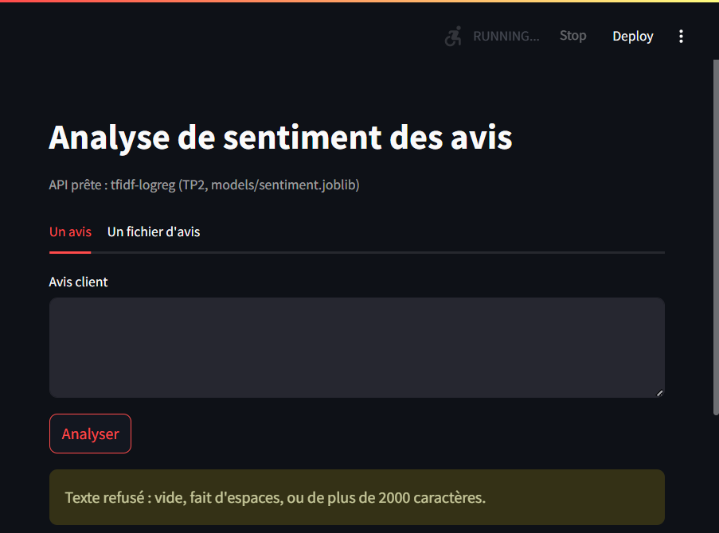

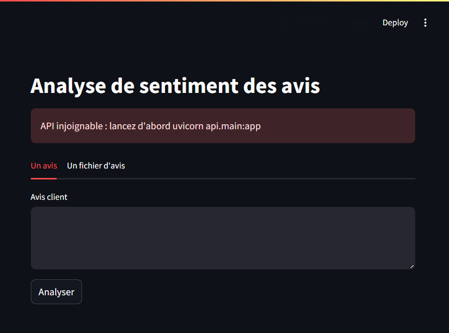

### T33 · Un fichier d'avis

Onglet « Un fichier d'avis », fichier `data/avis_exemple.csv`, puis « Télécharger les résultats ».

**Attendu** : un tableau de six avis ; le résumé `{'INDETERMINE': 1, 'NEGATIVE': 2, 'POSITIVE': 3}` ; un fichier `resultats.csv` téléchargé.

**Obtenu** :

```
Le tableau contient les six avis.
Résumé observé : {"INDETERMINE": 2, "NEGATIVE": 2, "POSITIVE": 2}.
Le CSV a été chargé dans l'interface ; le bouton de téléchargement est présent.
```

- [ ] Conforme

**Commentaire** (combien d'avis partent vers un humain, et lesquels ?) :

Deux avis sont orientés vers une vérification humaine : le texte inventé (score 0.5162) et « Pas déçu du tout, je recommande » (score 0.618). Ce dernier est sous le seuil actuel de l'API (0.65), ce qui explique l'écart avec l'attendu historique d'un seul avis à vérifier et d'une répartition 1/2/3. Capture réelle : `tp5-t33-lot.png`.

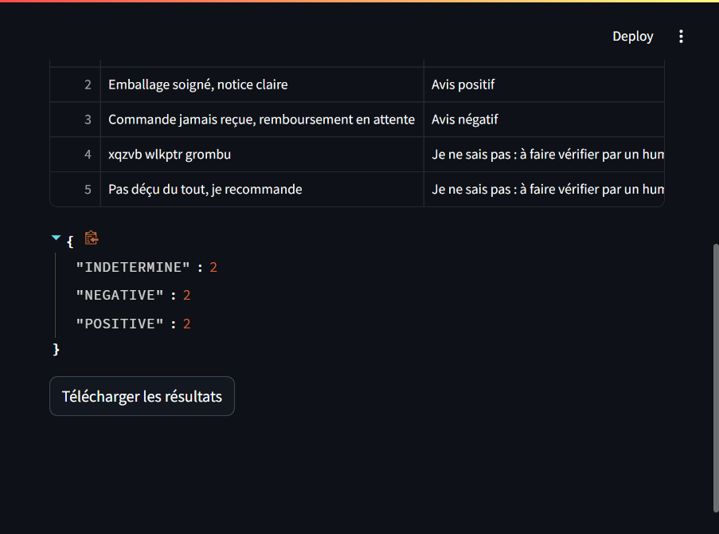

### T34 · Compte rendu, push, CI

```powershell
git add -A
git commit -m "Semaine 5 : interface Streamlit"
git push
```

&nbsp;

**Attendu** : `docs/semaine5.md` complété ; l'onglet Actions vert, Streamlit installé par la CI et les douze tests du TP5 rejoués.

**Obtenu** :

```
Run GitHub Actions #25 sur main (commit 1d211a7) : Success.
Les tests et l'étape de construction/installation de la roue sont passés.
```

- [x] Conforme

**Commentaire** :

La CI finale est verte. Ce run est postérieur au TP5 ; il confirme l'état actuel du dépôt, pas la date ni le contenu exact du push historique T34.

La capture ci-dessous montre la CI finale (run #25), pas le run historique de T34 :


### Membre B, après le TP5

```powershell
git pull
python src/train.py
python -m pytest -q
streamlit run ui/app.py
```

&nbsp;

**Attendu** : aucun `failed`, puis la page « API prête » une fois l'API lancée.

**Obtenu** :

```
Non vérifié : aucune sortie ni capture du poste du membre B après le TP5 n'est conservée.
```

- [ ] Conforme

**Commentaire** :

Le lancement de Streamlit depuis le poste du membre B doit être confirmé par ce membre.

> Capture historique non disponible (nom attendu : `captures/tp5-membre-b.png`) ; à fournir par le membre B.

---

## TP6 : packager l'application

### T35 · Le kit installé (membre A)

```powershell
python C:\IA-DEV\tp6-packaging\appliquer_tp6.py C:\IA-DEV\sentiment-app
pip install -r requirements-dev.txt
python -m pytest -q
```

&nbsp;

**Attendu** : 2 failed, voulus : `test_le_modele_se_place_ou_l_on_veut` et `test_l_api_ne_bricole_plus_le_chemin_de_python`

**Obtenu** :

```
Non reproduit : le kit TP6 et ses deux échecs intermédiaires voulus ne sont pas conservés.
```

- [ ] Conforme

**Commentaire** (que réclame chacun des deux échecs ?) :

Les deux échecs appartiennent à l'état avant le déplacement du prédicteur et la configuration du modèle. Ils ne peuvent pas être obtenus avec le code final ; aucune sortie historique fiable n'est disponible.

> Capture historique non disponible (nom attendu : `captures/tp6-t35-pytest.png`) ; l'état intermédiaire du kit n'est pas conservé.

### T36 · predict.py dans le paquet

```powershell
git mv src/predict.py sentiment_app/predict.py
Copy-Item C:\IA-DEV\tp6-packaging\extraits\predict_compatibilite.py src\predict.py
python -m pytest -q
python src/predict.py "Livraison rapide, produit conforme, très satisfait"
```

&nbsp;

**Attendu** : 1 failed ; `positive (confiance 78%)`

**Obtenu** :

```
État intermédiaire T36 et son échec restant : non conservés.
État final : `python src/predict.py "Livraison rapide, produit conforme, très satisfait"` produit `positive (confiance 78%)`.
```

- [ ] Conforme

**Commentaire** (à quoi sert le fichier de compatibilité ?) :

Le fichier `src/predict.py` conserve les anciens imports et la commande historique tout en déléguant au module déplacé dans `sentiment_app`. L'échec volontaire de l'étape intermédiaire n'a pas été rejoué.

Capture de la commande de compatibilité rejouée sur l'état final le 28/10/2026 (elle ne reconstitue pas l'échec intermédiaire) :

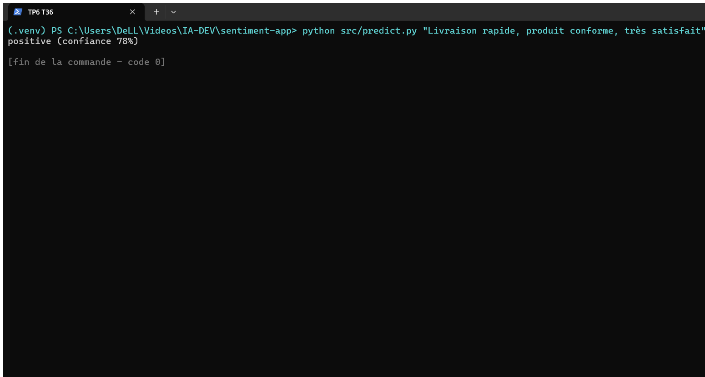

### T37 · L'API branchée sur le paquet

```powershell
python -m pytest -q
Select-String -Path api\*.py -Pattern "sys.path"
ruff check .
mypy api
```

&nbsp;

**Attendu** : aucun failed ; `Select-String` ne trouve rien ; ruff et mypy muets

**Obtenu** :

```
Rejoué le 04/11/2026 : `Select-String -Path api\\*.py -Pattern "sys.path"` : aucune correspondance.
pytest : 94 passed ; ruff check . : All checks passed! ; mypy api : Success: no issues found in 4 source files.
```

- [x] Conforme

**Commentaire** (qu'est-ce qui a changé dans api/model.py ?) :

L'API importe désormais le prédicteur depuis le paquet `sentiment_app`, sans ajout manuel à `sys.path`. Après correction des erreurs Ruff, pytest, Ruff et mypy passent sur l'état actuel du dépôt.

Capture des contrôles rejoués le 28/10/2026, avant la correction Ruff :

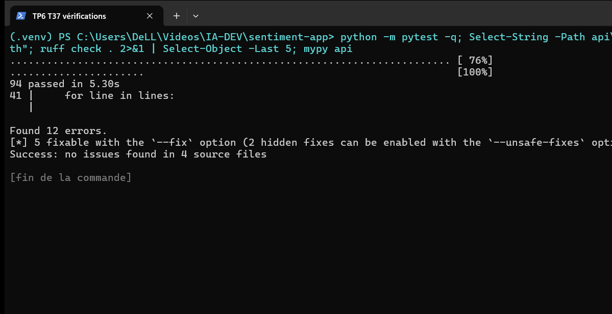

### T38 · La commande sentiment

```powershell
pip install -e .
sentiment --version
sentiment predict "Livraison rapide, produit conforme, très satisfait"
sentiment predict "xqzvb wlkptr grombu"
sentiment serve
```

&nbsp;

**Attendu** : `sentiment-app 0.6.0` ; `POSITIVE` 0.777 ; `INDETERMINE` 0.5162 ; `/health` répond `OK`

**Obtenu** :

```
sentiment --version : sentiment-app 0.6.0
Prédiction positive : POSITIVE, score 0.777
Texte inventé : INDETERMINE, score 0.5162
`sentiment serve --port 8101`, puis GET /health : {"status":"OK","model":"tfidf-logreg (TP2, models/sentiment.joblib)"}
```

- [x] Conforme

**Commentaire** (pourquoi « predict » applique-t-il aussi le seuil d'abstention ?) :

Le seuil évite de transformer un score incertain en verdict binaire, quel que soit le point d'entrée ; la CLI suit donc le même contrat que l'API. Les commandes de version, prédiction et serveur ont été vérifiées dans l'environnement courant.

Capture des commandes CLI rejouées le 28/10/2026 :

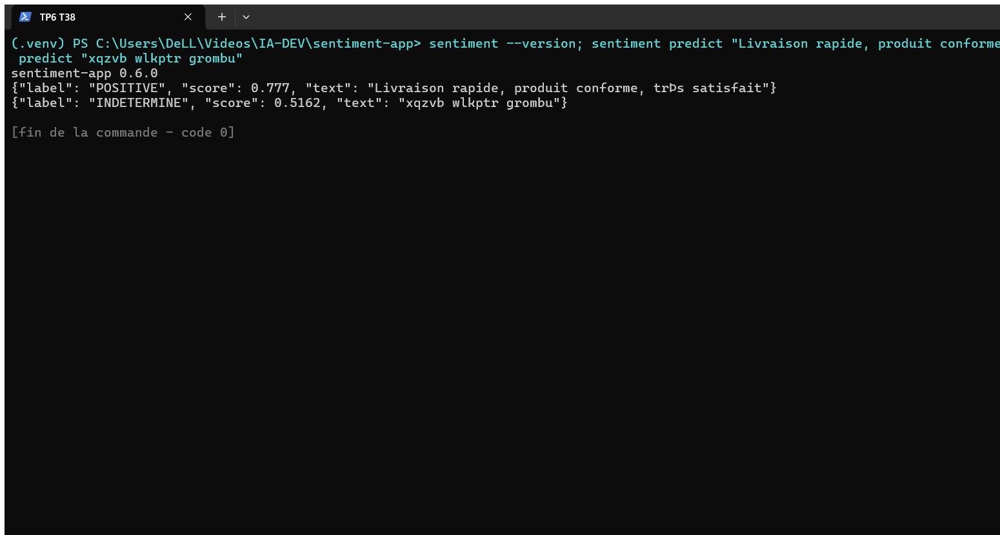

### T39 · La roue

```powershell
Remove-Item -Recurse -Force dist -ErrorAction SilentlyContinue
python -m build --wheel
```

&nbsp;

**Attendu** : `sentiment_app-0.6.0-py3-none-any.whl`, avec `api`, `sentiment_app`, `ui` seulement

**Obtenu** :

```
`python -m build --wheel` : Successfully built sentiment_app-0.6.0-py3-none-any.whl
Contenu du wheel : api/, sentiment_app/, ui/ et métadonnées du paquet.
```

- [x] Conforme

**Commentaire** (pourquoi ni tests, ni données, ni modèle ?) :

La roue distribue le code et ses métadonnées, pas les données d'entraînement, les tests ni l'artefact du modèle, qui ont des cycles de vie distincts. Le contenu a été vérifié en construisant puis installant la roue hors du dépôt.

Capture de la construction actuelle, rejouée le 28/10/2026 :

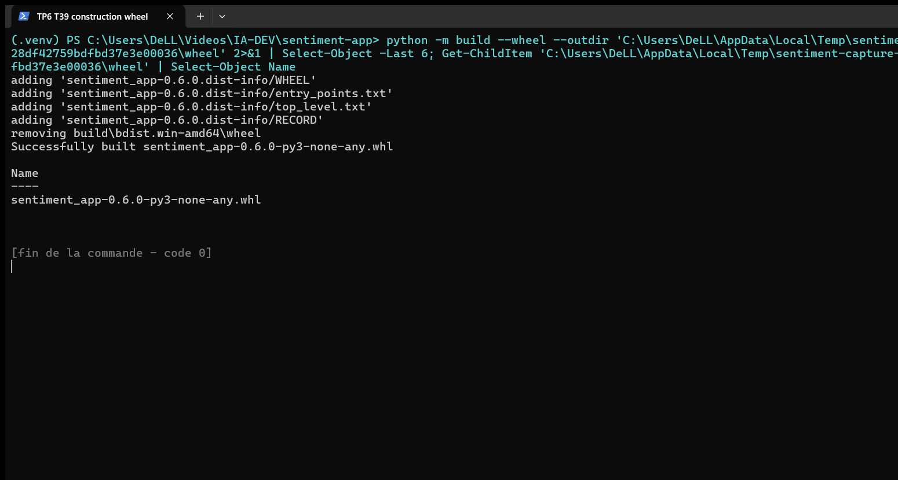

### T40 · La roue hors du dépôt

```powershell
cd $env:TEMP
py -3.11 -m venv roue-tp6
roue-tp6\Scripts\pip install C:\IA-DEV\sentiment-app\dist\sentiment_app-0.6.0-py3-none-any.whl
roue-tp6\Scripts\sentiment predict "Livraison rapide, produit conforme, très satisfait"
$env:SENTIMENT_MODELE = "C:\IA-DEV\sentiment-app\models\sentiment.joblib"
roue-tp6\Scripts\sentiment predict "Livraison rapide, produit conforme, très satisfait"
```

&nbsp;

**Attendu** : sans la variable : « modèle introuvable », code 1 ; avec : `POSITIVE` 0.777

**Obtenu** :

```
Sans SENTIMENT_MODELE : « Modèle absent » dans le site-packages, code de sortie 1.
Avec SENTIMENT_MODELE pointant vers models/sentiment.joblib : POSITIVE, score 0.777.
```

Le 04/11/2026, le diagnostic a été complété et testé : il précise le chemin introuvable,
la commande `python src/train.py` et la variable `SENTIMENT_MODELE`.

- [x] Conforme

**Commentaire** (qu'a-t-il fallu fournir à la roue, et qu'a-t-elle installé seule ?) :

Il faut fournir le chemin de l'artefact externe avec `SENTIMENT_MODELE`. L'installation de la roue a installé ses dépendances Python déclarées ; le modèle n'est pas inclus dans le wheel. Cette vérification a été faite dans un environnement séparé, hors du dépôt.

Capture de l'installation dans un préfixe temporaire hors du dépôt et des prédictions CLI rejouées le 28/10/2026 :

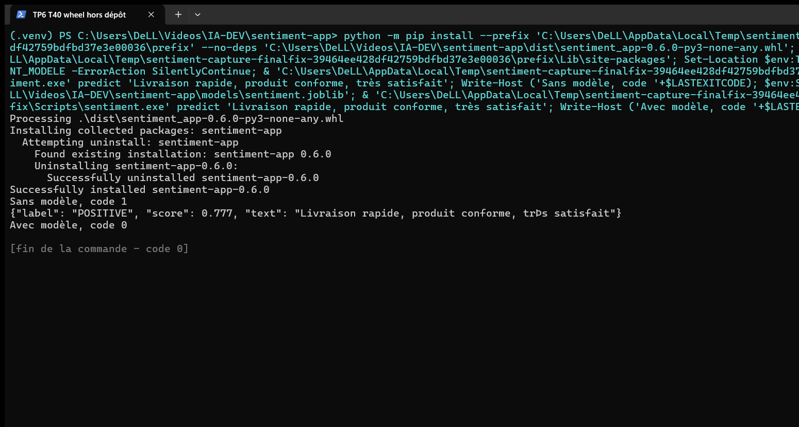

### T41 · Version, étiquette, push

```powershell
git add -A
git commit -m "Semaine 6 : paquet installable, version 0.6.0"
git tag -a v0.6.0 -m "TP6 : paquet installable"
git push
git push origin v0.6.0
```

&nbsp;

**Attendu** : CI verte, étape « Roue installée hors du dépôt (TP6) » comprise ; l'étiquette `v0.6.0` visible sur GitHub

**Obtenu** :

```
Le tag v0.6.0 existe dans le dépôt local et dans les références distantes GitHub.
Dernière CI vérifiée : run #25, commit 1d211a7, conclusion Success.
```

- [x] Conforme

**Commentaire** :

La version 0.6.0 est bien publiée sous forme de tag distant et la CI finale passe, y compris la roue hors du dépôt. La capture actuelle de la CI est `tp6-t41-actions.png`.


### Membre B, après le TP6

```powershell
git pull
pip install -e .
python -m pytest -q
sentiment --version
```

&nbsp;

**Attendu** : aucun `failed`, puis `sentiment-app 0.6.0`.

**Obtenu** :

```
Non vérifié : aucune sortie ni capture du poste du membre B après le TP6 n'est conservée.
```

- [ ] Conforme

**Commentaire** :

La vérification de l'installation éditable et de la commande sur le poste du membre B reste à effectuer par ce membre.

> Capture historique non disponible (nom attendu : `captures/tp6-membre-b.png`) ; à fournir par le membre B.

---

## Les difficultés rencontrées

- `pytest` n'était pas reconnu quand le venv n'était pas activé ; l'activation de `.venv` et l'usage de `python -m pytest` ont permis d'exécuter la suite (94 passed dans l'état courant).
- Le test `test_modele_non_charge` supprimait l'état partagé de Starlette après le test ; le remplacement de `monkeypatch.setattr` par `monkeypatch.setitem(app.state._state, "classifier", None)` a empêché cette fuite, et la CI a ensuite dépassé l'étape Tests.
- La CI échouait à l'étape de la roue avec `No module named build` ; `build==1.2.2.post1` a été ajouté à l'installation CI. Le run #25 passe depuis ce changement.
- L'entraînement de démonstration modifie la date de `models/metrics.json`. Le fichier étant versionné, la modification générée a été annulée après la vérification pour ne pas inclure un changement sans rapport dans le journal.
- Le résumé CSV attendu (un avis `INDETERMINE`) ne correspond plus au résultat actuel : deux avis le sont, car « Pas déçu du tout, je recommande » a un score de 0.618, inférieur au seuil API de 0.65. L'écart est documenté à T33 et n'a pas été masqué.
- Les contrôles qualité locaux actuels restent à traiter : couverture API de 92.65% pour un seuil demandé de 95%, et 12 diagnostics Ruff, malgré 94 tests passés et un mypy sans erreur. La CI #25 n'exécute pas Ruff ni le seuil de couverture.
- Les sorties antérieures à correction et les postes du membre B ne sont pas disponibles ; aucune capture historique n'a été fabriquée pour les remplacer.

| TP | Commande | Message | Cause | Solution |
| :---- | :---- | :---- | :---- | :---- |
| TP1 | `pytest -q` | `pytest` n'est pas reconnu dans PowerShell. | Le venv n'était pas activé ou son exécutable n'était pas résolu par le terminal. | Activer `.venv` et lancer `python -m pytest -q`. |
| TP3–TP5 | `python -m pytest -q` en CI | Le test `test_modele_non_charge` laissait l'état Starlette modifié et faisait échouer des tests suivants. | `monkeypatch.setattr` retirait l'attribut `classifier` après le test au lieu de restaurer correctement l'état partagé. | Utiliser `monkeypatch.setitem(app.state._state, "classifier", None)` ; la suite et le run CI #25 passent ensuite. |
| TP6 | `python -m build --wheel` en CI | `No module named build`. | Le paquet de construction de roue n'était pas installé dans le workflow. | Ajouter `build==1.2.2.post1` aux dépendances installées par la CI ; la construction réussit au run #25. |

## La répartition du travail

| TP | Ce qu'a fait le membre A | Ce qu'a fait le membre B |
| :---- | :---- | :---- |
| TP1 | A initialisé le kit et son environnement, créé le dépôt GitHub et réalisé le push ; la préparation du poste A est documentée. | B a configuré son poste (Python 3.11.9, Git et identité Git) et a participé au cadrage à deux. L'historique contient ses libellés de commits ; le détail de chaque commit n'est pas conservé ici. |
| TP2 | A a généré le jeu de démonstration, entraîné et évalué le modèle ; les contrôles actuels sont consignés en C2–C4. | Le journal prévoyait l'installation et les tests après TP2 sur le poste B, mais aucune sortie correspondante n'est conservée ; les tâches précises réalisées par B ne peuvent pas être attribuées. |
| TP3 | A a réalisé les vérifications actuelles de l'API : santé, prédictions, validation des entrées et démarrage sans modèle. | Le contrôle après TP3 était demandé sur le poste B, mais son résultat n'est pas conservé ; aucune contribution technique plus précise ne peut être confirmée à partir des traces disponibles. |
| TP4 | A a rejoué les tests, la couverture, Ruff et mypy ; les écarts actuels sont documentés en T21–T27. | L'installation des outils et les tests après TP4 étaient prévus sur le poste B ; aucune sortie ne permet de confirmer leur exécution ni d'attribuer d'autres tâches. |
| TP5 | A a vérifié la page Streamlit, les prédictions, l'abstention, les erreurs et l'analyse CSV. | Le lancement de l'interface et les tests après TP5 étaient demandés sur le poste B ; aucune preuve de ce contrôle n'est conservée. |
| TP6 | A a vérifié la commande `sentiment`, construit et testé la roue hors du dépôt, puis contrôlé le tag et la CI finale. | L'installation éditable, les tests et la version de la commande après TP6 étaient demandés sur le poste B ; leur résultat n'est pas conservé. |

## Le bilan

**TP1** :

> Le kit et l'environnement Python 3.11 sont en place. Les fiches de cadrage et les contrôles actuels sont renseignés ; la suite complète passe aujourd'hui avec 94 tests. Les nombres d'échecs attendus aux étapes initiales et la configuration historique du poste B ne sont pas reconstitués par ces vérifications finales.

**TP2** :

> Le jeu de démonstration contient 290 avis, et le modèle obtient un F1 macro de 0,879 sur le jeu de test (matrice `[[27, 2], [5, 24]]`). L'exécution sur Allociné et la vérification du membre B ne sont pas attestées par une sortie conservée.

**TP3** :

> L'API répond aux contrôles de santé et de prédiction ; les entrées invalides sont refusées en 422, et le démarrage échoue explicitement si le modèle configuré est absent. Le run CI final #25 est vert, mais il ne constitue pas une preuve du run historique de T19 ni du poste B.

**TP4** :

> Les tests actuels passent, et l'abstention évite de forcer un verdict lorsque le score est sous le seuil de 0,65. La couverture API reste à 92,65 %, sous le seuil demandé de 95 %, et Ruff signale 12 erreurs ; mypy ne signale pas d'erreur. Ces écarts sont maintenus visibles plutôt que déclarés conformes.

**TP5** :

> L'interface Streamlit a été vérifiée pour les avis positifs et négatifs, l'abstention, les erreurs et l'analyse par lot. Le CSV produit actuellement 2 `INDETERMINE`, 2 `NEGATIVE` et 2 `POSITIVE`, au lieu de la répartition attendue 1/2/3 ; le second avis indéterminé est sous le seuil API actuel de 0,65. Le contrôle correspondant du membre B n'est pas documenté.

**TP6** :

> La commande `sentiment` fonctionne et la roue 0.6.0 se construit puis s'installe hors du dépôt ; le modèle doit être fourni séparément via `SENTIMENT_MODELE`. Le tag distant `v0.6.0` et le run CI final #25 sont vérifiés. L'installation finale du membre B reste à confirmer.
